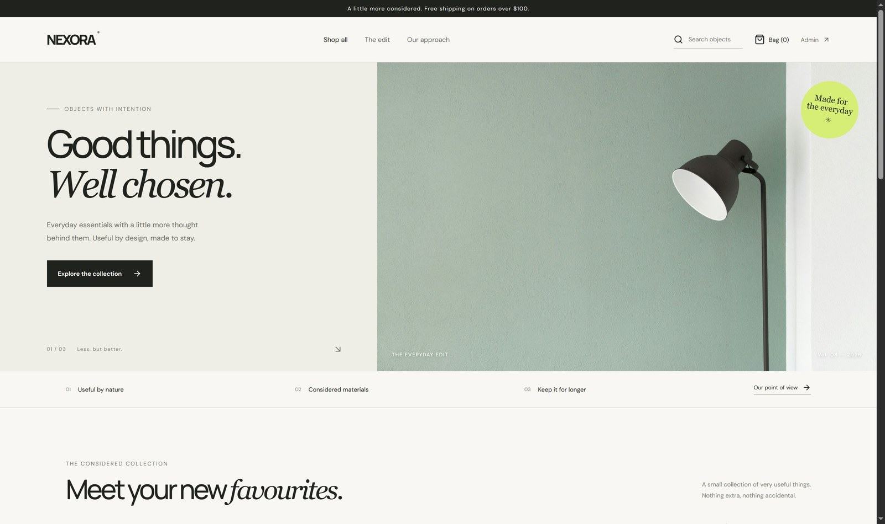

# NEXORA Commerce

[](https://github.com/Ahoura-CodeR/nexora/actions/workflows/ci.yml)

A commerce storefront and operations dashboard built to explore the parts of a small commerce system that get interesting beyond product cards: inventory consistency, order creation, sessions, role checks, and API boundaries.

**Live demo:** https://nexora-demo-zz01.onrender.com — browse the catalog and the cart, or sign in as `admin@nexora.local` / `ChangeMe123!` for the admin views. The free instance sleeps when idle, so the first request after a pause can take a minute or two to wake up.



## What's in here

- Responsive storefront with search, category filters, product detail pages, and a persistent cart
- Customer registration and login backed by Redis sessions
- PostgreSQL catalog, users, orders, and order-item snapshots
- Order creation with server-side pricing, conditional inventory decrements, a serializable transaction, and idempotency keys
- Admin summary, product management endpoints, and order status transitions
- Request validation, centralized API errors, rate-limited authentication routes, structured logs, and health endpoint
- Vitest tests, Docker Compose for local services, and a basic CI workflow

Payments are simulated. The project does not charge cards or connect to a payment provider.

## Stack

React, TypeScript, Vite, Express, PostgreSQL, Prisma, Redis, Zod, Vitest, Supertest, and Docker Compose.

## Run locally

Requirements: Node.js 22+, npm 10+, and Docker with Compose.

```bash
cp .env.example .env
docker compose up -d
npm install
npm run db:generate
npm run db:migrate -- --name init
npm run db:seed
npm run dev
```

- Web: <http://localhost:5173>
- API: <http://localhost:4000/api>
- Health: <http://localhost:4000/api/health>

Workspace API scripts load the root `.env` explicitly. Prisma commands use the same file through `dotenv-cli`.

### Seeded admin

- Email: ``
- Password: ``

This account is for local development only. Change the password and remove or replace the seed credentials before deploying anywhere public.

## Useful commands

```bash
npm run build
npm test
npm run lint
npm run db:generate
npm run db:migrate -- --name describe-your-change
npm run db:seed
```

## Configuration

Copy `.env.example` to `.env`. `SESSION_SECRET` must be a random string of at least 24 characters. `WEB_ORIGIN` must match the frontend origin. Set `COOKIE_SECURE=true` behind HTTPS. PostgreSQL and Redis must be available before the API starts accepting authenticated requests.

## Order flow and consistency

The client sends product IDs, quantities, and an idempotency key. The API resolves current prices from PostgreSQL, conditionally decrements inventory, and writes the order and item snapshots inside one serializable transaction. Reusing an idempotency key for the same user returns the original order rather than creating another one. Client-provided totals are never trusted.

## Project layout

```text
apps/web       React storefront and operations UI
apps/api       Express API, Prisma schema, and tests
packages/shared Request schemas shared across workspaces
docs           Architecture notes and endpoint reference
```

## Known gaps

This is a portfolio-scale implementation, not a payment-ready commerce product. Payment-provider integration, CSRF protection, email verification, password reset, inventory reservation expiry, shipping/tax integrations, comprehensive end-to-end coverage, and production observability are intentionally outside the current scope. Review `docs/architecture.md` before extending the order flow.

## License

MIT. See [LICENSE](./LICENSE).
